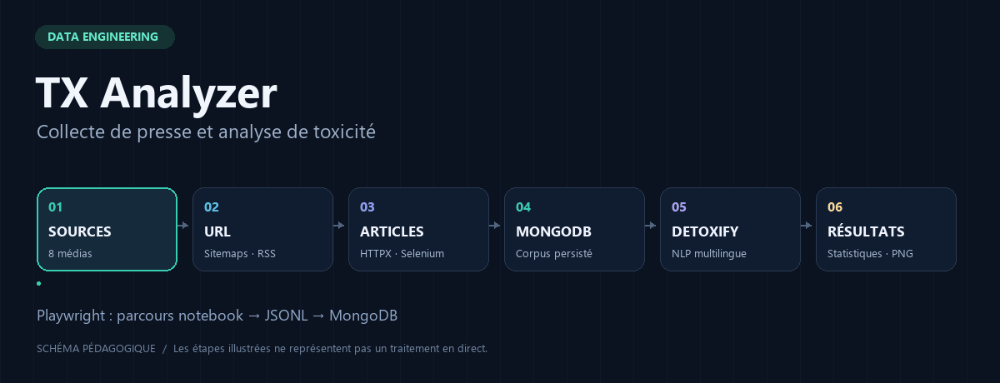
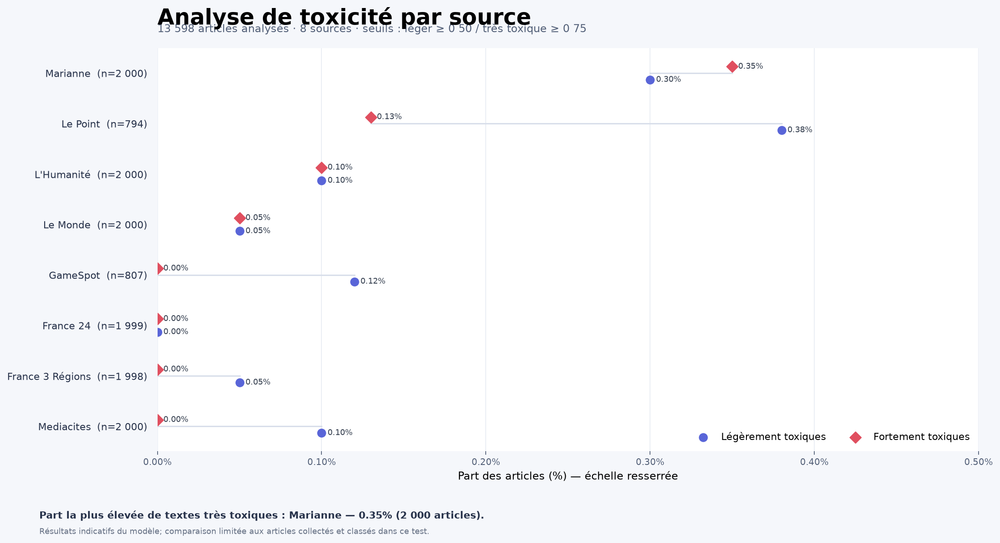
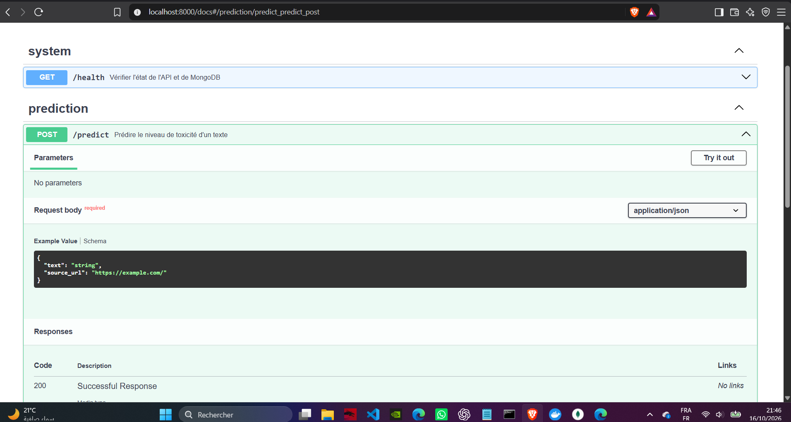
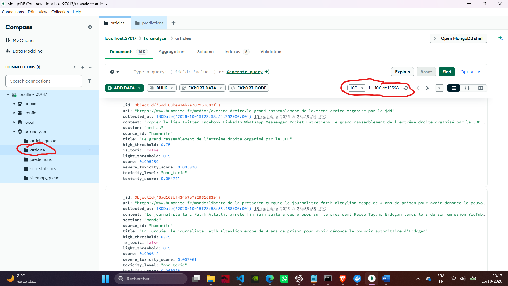
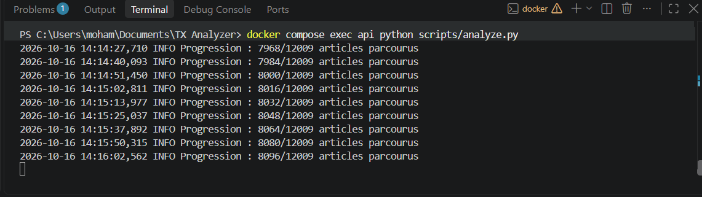
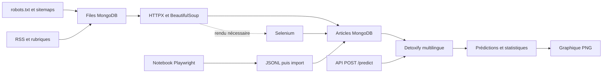

# TX Analyzer



[Version statique du schéma](docs/assets/pipeline-poster.png)

**Des sitemaps aux statistiques de toxicité : collecte, traitement NLP, persistance et API.**


TX Analyzer découvre les articles de huit sources de presse, extrait leur texte, estime leur toxicité avec Detoxify multilingue et calcule des statistiques par source. MongoDB conserve la progression de collecte, les articles et les prédictions. FastAPI expose la classification d’un texte à la demande.

**[Collecte et sitemaps](docs/collecte.md) · [Commandes](docs/utilisation.md) · [Playwright](docs/playwright.md) · [API et données](docs/api-et-donnees.md)**

## Ce que montre le projet

- Découverte des URL depuis robots.txt, sitemaps XML ou gzip, flux RSS et rubriques.
- Extraction HTTPX / BeautifulSoup, complétée par Selenium pour le rendu navigateur.
- Files persistées et dédupliquées dans MongoDB pour reprendre les traitements.
- Automatisation Playwright dans le notebook Le Point / GameSpot, avec export JSONL et import MongoDB.
- Classification multilingue par lots, statistiques par source et graphique PNG.
- API REST avec validation des requêtes et documentation OpenAPI interactive.


## Résultats présentés dans le rapport

Le rapport de livraison documente une analyse complète de **13 598 articles sur huit sources**, après import des collectes Playwright et mise à jour des prédictions. Il s’agit de l’instantané du rapport, et non d’un compteur actualisé depuis la base.

| Articles analysés | Sources | Le Point après déduplication | GameSpot après déduplication |
| :---: | :---: | :---: | :---: |
| **13 598** | **8** | **794** | **807** |



Le graphique utilise les seuils de 0,50 et 0,75. L’axe des pourcentages est resserré : les valeurs restent faibles. Les résultats décrivent ce corpus et les sorties du modèle; ils ne permettent pas de classer globalement les médias.

### Aperçu de l’API



L’interface FastAPI expose les deux routes et permet d’essayer une prédiction depuis le navigateur. Voir [le contrat de l’API](docs/api-et-donnees.md).

<details>
<summary><strong>Voir le stockage MongoDB et une étape de l’analyse</strong></summary>



La capture illustre le stockage des articles, leur source, leur URL et les champs de classification.



Cette capture montre une étape intermédiaire, antérieure à l’analyse complète de 13 598 articles. Elle illustre les journaux de progression.

</details>

[Consulter les légendes et la provenance des visuels](docs/visuels.md).

## Vue du pipeline

<details>
<summary>Ouvrir le diagramme technique des deux parcours de collecte</summary>



</details>

Le collecteur intégré utilise des files pour sa reprise; le notebook suit son propre parcours d’export et d’import. Les guides détaillent chaque mécanisme et les fonctions associées.

## Démarrage rapide

Prérequis : Docker Desktop avec Docker Compose. Les commandes sont prévues pour PowerShell.

```powershell
git clone https://github.com/amine0891/tx-analyzer.git
cd tx-analyzer
Copy-Item .env.example .env
docker compose up --build -d
```

Ouvrir [la documentation interactive](http://localhost:8000/docs). [Le point de santé](http://localhost:8000/health) vérifie l’API et MongoDB; la première prédiction charge et, si nécessaire, télécharge les poids du modèle.

```powershell
$body = @{ text = "Exemple de texte à analyser" } | ConvertTo-Json
Invoke-RestMethod -Method Post -Uri http://localhost:8000/predict -ContentType "application/json; charset=utf-8" -Body ([System.Text.Encoding]::UTF8.GetBytes($body))
```

## Collecter, analyser, restituer

```powershell
# Petit passage de collecte sur une source
docker compose --profile scraping run --build --rm scraper python scripts/collect.py --source humanite --max-sitemaps 2 --max-articles 1

# Classer les articles stockés et calculer un instantané global
docker compose exec api python scripts/analyze.py

# Exporter vers output/toxicite_par_site.png
docker compose exec api python scripts/generate_dashboard.py
```

Le plafond de jobs traités ne garantit pas autant d’articles valides. Le [guide d’utilisation](docs/utilisation.md) décrit les limites, la découverte seule, la reprise, le mode visible et la collecte périodique.

## Structure du dépôt

| Chemin | Rôle |
| --- | --- |
| [`app/scraping/sources.py`](app/scraping/sources.py) | Profils, sélecteurs et filtres propres aux sources |
| [`app/scraping/collector.py`](app/scraping/collector.py) | Robots.txt, sitemaps, files, flux RSS, pages de rubrique, extraction et persistance |
| [`app/scraping/browser.py`](app/scraping/browser.py) | Rendu Selenium et navigateur semi-automatique |
| [`scripts/collect.py`](scripts/collect.py) | Commande de collecte ponctuelle |
| [`scripts/collect_manual.py`](scripts/collect_manual.py) | Commande du parcours navigateur visible |
| [`scripts/worker.py`](scripts/worker.py) | Collecte périodique des sources automatiques |
| [`lepoint.ipynb`](lepoint.ipynb) | Automatisation Playwright exploratoire Le Point / GameSpot et import JSONL |
| [`app/ml/classifier.py`](app/ml/classifier.py) | Prédiction Detoxify et mise en forme des scores |
| [`scripts/analyze.py`](scripts/analyze.py) | Classification des articles collectés et statistiques par source |
| [`scripts/generate_dashboard.py`](scripts/generate_dashboard.py) | Génération du graphique des résultats |
| [`app/api/routes.py`](app/api/routes.py) | Routes `/health` et `/predict` de l'API |
| [`docker-compose.yml`](docker-compose.yml) | Services API, MongoDB, collecteurs et volumes |


## Documentation

| Guide | Contenu |
| --- | --- |
| [Collecte](docs/collecte.md) | Parcours sitemap → URL → article, profils et fonctions du code |
| [Utilisation](docs/utilisation.md) | Commandes, configuration, analyse et dépannage |
| [Playwright](docs/playwright.md) | Installation, connexion CDP, cellules et import JSONL |
| [API et données](docs/api-et-donnees.md) | Routes REST, scores et collections MongoDB |
| [Galerie du rapport](docs/visuels.md) | Captures, graphique, chronologie et provenance |
| [Contribuer](CONTRIBUTING.md) | Adapter une source et préparer une modification |

## Limites actuelles

Les scores sont des estimations sensibles aux citations, au contexte et à la langue. Les pourcentages décrivent les articles collectés et classés, pas l’ensemble des publications d’un média. Le dépôt ne contient pas de jeu de données public ni de mesure de performance du modèle.

Les profils de scraping doivent évoluer avec les sites. Le notebook demande une configuration locale. L’API constitue une démonstration locale; authentification et contrôle d’accès doivent être ajoutés avant une exposition publique.
