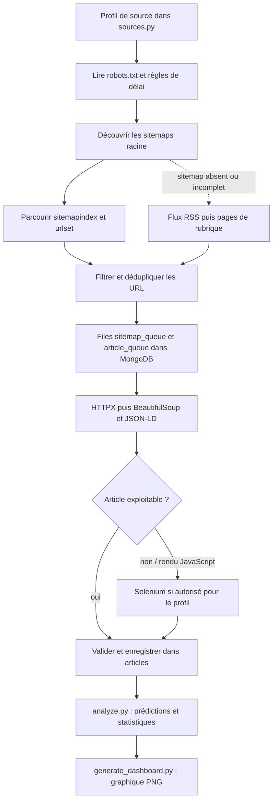

# TX Analyzer

**TX Analyzer** est un pipeline Python de collecte d'articles de presse et d'analyse de leur toxicité. Il découvre les URL par sitemaps, flux RSS et pages de rubrique, conserve sa progression dans MongoDB, extrait le contenu des articles, puis le classe avec le modèle multilingue Detoxify. Une API FastAPI permet aussi d'analyser un texte directement.

Le projet contient deux parcours de collecte à distinguer :

1. Le **collecteur de l'application**, piloté par scripts Python et fondé sur HTTPX/BeautifulSoup avec repli Selenium pour les pages qui nécessitent un navigateur.
2. Le **notebook Playwright**, parcours exploratoire séparé pour Le Point et GameSpot qui exporte des résultats JSONL avant leur import dans MongoDB.

## Parcours du collecteur de l'application



### 1. Configuration des sources

[`app/scraping/sources.py`](app/scraping/sources.py) est le registre des sources. Chaque `Source` déclare notamment son domaine, les pages de rubrique de secours, le motif de chemin d'article, les sélecteurs CSS du corps, les exclusions d'URL, les flux RSS éventuels et son mode (`automatic` ou `manual`). C'est ici qu'on adapte les règles propres à un site.

### 2. Robots.txt, sitemaps et découverte des URL

La logique se trouve dans [`app/scraping/collector.py`](app/scraping/collector.py), dans `collect_source()` et ses fonctions d'aide :

- `_robots_policy()` lit `/robots.txt`, récupère les sitemaps déclarés et le délai d'exploration. Si aucun sitemap n'y est déclaré, le collecteur essaie `/sitemap.xml`.
- `_sitemap_roots()` sélectionne les sitemaps racine du domaine et, pour certains domaines localisés, privilégie la langue correspondante.
- `_xml_root_and_locs()` lit les XML `sitemapindex` et `urlset`, y compris les fichiers `.gz`.
- Pour un `sitemapindex`, chaque sitemap enfant du même domaine est ajouté à `sitemap_queue`.
- Pour un `urlset`, les URL sont filtrées par `_is_article_candidate()` selon le motif de la source. Les fichiers médias, rubriques, pages d'index et paginations sont écartés; les URL retenues vont dans `article_queue` avec leur rubrique.
- Les jobs sont dédupliqués par `_enqueue()`. Les états et tentatives sont conservés dans MongoDB : une exécution suivante peut reprendre les URL en attente ou réessayer certaines erreurs. Les sitemaps racine sont relus à chaque cycle pour découvrir les nouvelles publications.

Si la découverte par sitemap échoue, ne fournit pas d'articles en attente ou remonte une erreur, le code essaie les flux explicitement déclarés dans `feed_paths` via `_discover_from_feeds()`, puis les pages publiques configurées via `_discover_from_listings()`. Les pages de rubrique peuvent fournir directement des liens d'articles; la pagination et, pour GameSpot, le bouton de chargement supplémentaire sont gérés selon le profil de source.

### 3. Téléchargement et extraction

Le collecteur traite d'abord les URL en attente de `article_queue`, en alternant les rubriques pour répartir la collecte. Il vérifie le domaine, les règles d'accès et si l'article existe déjà. HTTPX récupère le HTML; BeautifulSoup, les sélecteurs CSS du profil et les données JSON-LD servent à extraire titre et texte. Le modèle `Article` est validé avant l'enregistrement dans la collection MongoDB `articles`.

Le rendu navigateur est défini dans [`app/scraping/browser.py`](app/scraping/browser.py) et déclenché depuis `collector.py` lorsqu'une page est probablement rendue en JavaScript, ou dans certains cas de réponse HTTP 403. Ce repli utilise **Selenium**, pas Playwright. Les sources en mode `manual` nécessitent le lanceur [`scripts/collect_manual.py`](scripts/collect_manual.py), qui ouvre le navigateur visible pour les étapes semi-automatiques. Les écrans de blocage et réponses 429 ne sont pas contournés; la collecte respecte les règles déclarées et les autorisations applicables.

### 4. Lancement et persistance

- [`scripts/collect.py`](scripts/collect.py) lance une collecte ponctuelle, avec choix de source, limites, mode `--sitemaps-only` et reprise des lots.
- [`scripts/worker.py`](scripts/worker.py) relance périodiquement les sources `automatic` (intervalle réglé par `COLLECT_INTERVAL_SECONDS`).
- [`scripts/collect_manual.py`](scripts/collect_manual.py) lance le parcours semi-automatique pour les sources configurées en `manual`.
- Les plafonds par exécution et le plafond cumulatif par source évitent une collecte sans limite; le défaut du collecteur est de 2 000 articles par source.

Les collections `sitemap_queue` et `article_queue` sont les files de découverte et de reprise. Les articles eux-mêmes sont enregistrés dans `articles`. Les scripts d'analyse écrivent les prédictions et statistiques dans MongoDB.

## Parcours Playwright du notebook

[`lepoint.ipynb`](lepoint.ipynb) est un parcours **séparé du collecteur de l'application**. Il n'est pas lancé par `scripts/collect.py` et n'utilise pas les files `sitemap_queue` / `article_queue`. Il utilise Playwright pour automatiser un navigateur Chromium déjà exposé via Chrome DevTools Protocol à `http://localhost:9222`.

Le notebook est organisé en cellules :

1. **Diagnostic Le Point** : inspecte les liens présents sur une rubrique pour repérer les formats d'URL d'articles.
2. **Collecte Le Point** : ouvre une page de départ, récupère le contenu de l'article depuis `window.Fusion.globalContent` lorsqu'il est disponible, collecte des URL depuis les pages de rubrique en cliquant sur le bouton de chargement supplémentaire, puis écrit les articles dans `lepoint_articles.jsonl` (cible configurée dans la cellule).
3. **Collecte GameSpot** : lit les flux RSS configurés, complète la découverte depuis les catégories avec le bouton de chargement supplémentaire, extrait les champs de l'article et écrit `gamespot_articles.jsonl`.
4. **Import MongoDB** : la dernière cellule lit le JSONL GameSpot et fait des upserts par URL par lots dans `tx_analyzer.articles`.

Les sorties d'exécution enregistrées dans le notebook ont été retirées pour que Git contienne les cellules de code sans embarquer les résultats de scraping. Pour exécuter ce parcours, installer Jupyter et Playwright et disposer d'un Chromium accessible via le port CDP configuré dans le notebook. Il s'agit d'un prototype autonome; pour la collecte intégrée et persistée/reprenable, le code principal est sous `app/scraping/` et `scripts/`.

## Structure du dépôt

| Chemin | Rôle |
| --- | --- |
| [`app/scraping/sources.py`](app/scraping/sources.py) | Profils, sélecteurs et filtres propres aux sources |
| [`app/scraping/collector.py`](app/scraping/collector.py) | Robots.txt, sitemaps, files, flux RSS, pages de rubrique, extraction et persistance |
| [`app/scraping/browser.py`](app/scraping/browser.py) | Rendu Selenium et navigateur semi-automatique |
| [`scripts/collect.py`](scripts/collect.py) | Commande de collecte ponctuelle |
| [`scripts/collect_manual.py`](scripts/collect_manual.py) | Commande du parcours navigateur visible |
| [`scripts/worker.py`](scripts/worker.py) | Collecte périodique des sources automatiques |
| [`lepoint.ipynb`](lepoint.ipynb) | Automatisation Playwright exploratoire Le Point / GameSpot et import JSONL |
| [`app/ml/classifier.py`](app/ml/classifier.py) | Prédiction Detoxify et mise en forme des scores |
| [`scripts/analyze.py`](scripts/analyze.py) | Classification des articles collectés et statistiques par source |
| [`scripts/generate_dashboard.py`](scripts/generate_dashboard.py) | Génération du graphique des résultats |
| [`app/api/routes.py`](app/api/routes.py) | Routes `/health` et `/predict` de l'API |
| [`docker-compose.yml`](docker-compose.yml) | Services API, MongoDB, collecteurs et volumes |

## Démarrage rapide

### Prérequis

- Docker et Docker Compose
- Une connexion Internet pour télécharger l'image MongoDB et les poids du modèle au premier démarrage

### Lancer l'API et MongoDB

Depuis la racine du projet :

```powershell
Copy-Item .env.example .env
docker compose up --build -d
```

L'API est disponible sur `http://localhost:8000`. La documentation interactive est sur `http://localhost:8000/docs`; l'état de l'API et de MongoDB est vérifiable sur `http://localhost:8000/health`.

### Envoyer une prédiction

```powershell
curl.exe -X POST http://localhost:8000/predict `
  -H "Content-Type: application/json" `
  -d '{"text":"Exemple de texte à analyser","source_url":"https://example.org/article"}'
```

La réponse contient `prediction`, `toxicity_level` et `score`. La prédiction est enregistrée dans MongoDB.

### Faire un petit essai du collecteur intégré

```powershell
docker compose --profile scraping run --build --rm scraper python scripts/collect.py --max-sitemaps 2 --max-articles 1
```

Pour découvrir les URL depuis les sitemaps sans encore télécharger les articles, ajouter `--sitemaps-only`. Les options détaillées sont dans `python scripts/collect.py --help`.

## Configuration et précautions

Copie `.env.example` vers `.env` pour régler le port, la base MongoDB, les délais et les seuils du classifieur. `.env` est ignoré par Git : n'y place pas de secret à publier. Le cache des poids Detoxify est conservé dans un volume Docker. La classification s'exécute localement dans le conteneur.

Avant de lancer une collecte, vérifier les conditions d'utilisation et autorisations applicables aux sites choisis, et commencer par de petits plafonds. La disponibilité, les sélecteurs et les protections des sites évoluent; une collecte peut donc produire moins d'articles que son plafond.

## Technologies

Python 3.12 · FastAPI · Detoxify · MongoDB · Docker Compose · HTTPX · BeautifulSoup · Selenium · Playwright (notebook)

## État du projet

Projet de démonstration Data Engineering en évolution. Les scores du modèle sont des estimations automatiques, pas une décision définitive sur le contenu.
