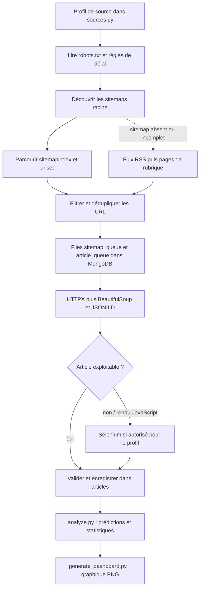

# Collecte : des sitemaps aux articles

[Accueil](../README.md) · [Commandes](utilisation.md) · [Playwright](playwright.md)

## Parcours du collecteur de l'application

### 1. Configuration des sources

[`app/scraping/sources.py`](../app/scraping/sources.py) est le registre des sources. Chaque `Source` déclare notamment son domaine, les pages de rubrique de secours, le motif de chemin d'article, les sélecteurs CSS du corps, les exclusions d'URL, les flux RSS éventuels et son mode (`automatic` ou `manual`). C'est ici qu'on adapte les règles propres à un site.

### 2. Robots.txt, sitemaps et découverte des URL

La logique se trouve dans [`app/scraping/collector.py`](../app/scraping/collector.py), dans `collect_source()` et ses fonctions d'aide :

- `_robots_policy()` lit `/robots.txt`, récupère les sitemaps déclarés et le délai d'exploration. Si aucun sitemap n'y est déclaré, le collecteur essaie `/sitemap.xml`.
- `_sitemap_roots()` sélectionne les sitemaps racine du domaine et, pour certains domaines localisés, privilégie la langue correspondante.
- `_xml_root_and_locs()` lit les XML `sitemapindex` et `urlset`, y compris les fichiers `.gz`.
- Pour un `sitemapindex`, chaque sitemap enfant du même domaine est ajouté à `sitemap_queue`.
- Pour un `urlset`, les URL sont filtrées par `_is_article_candidate()` selon le motif de la source. Les fichiers médias, rubriques, pages d'index et paginations sont écartés; les URL retenues vont dans `article_queue` avec leur rubrique.
- Les jobs sont dédupliqués par `_enqueue()`. Les états et tentatives sont conservés dans MongoDB : une exécution suivante peut reprendre les URL en attente ou réessayer certaines erreurs. Les sitemaps racine sont relus à chaque cycle pour découvrir les nouvelles publications.

Si la découverte par sitemap échoue, ne fournit pas d'articles en attente ou remonte une erreur, le code essaie les flux explicitement déclarés dans `feed_paths` via `_discover_from_feeds()`, puis les pages publiques configurées via `_discover_from_listings()`. Les pages de rubrique peuvent fournir directement des liens d'articles; la pagination et, pour GameSpot, le bouton de chargement supplémentaire sont gérés selon le profil de source.

### 3. Téléchargement et extraction

Le collecteur traite d'abord les URL en attente de `article_queue`, en alternant les rubriques pour répartir la collecte. Il vérifie le domaine, les règles d'accès et si l'article existe déjà. HTTPX récupère le HTML; BeautifulSoup, les sélecteurs CSS du profil et les données JSON-LD servent à extraire titre et texte. Le modèle `Article` est validé avant l'enregistrement dans la collection MongoDB `articles`.

Le rendu navigateur est défini dans [`app/scraping/browser.py`](../app/scraping/browser.py) et déclenché depuis `collector.py` lorsqu'une page est probablement rendue en JavaScript, ou dans certains cas de réponse HTTP 403. Ce repli utilise **Selenium**, pas Playwright. Les sources en mode `manual` nécessitent le lanceur [`scripts/collect_manual.py`](../scripts/collect_manual.py), qui ouvre le navigateur visible pour les étapes semi-automatiques. Les écrans de blocage et réponses 429 ne sont pas contournés; la collecte respecte les règles déclarées et les autorisations applicables.

### 4. Lancement et persistance

- [`scripts/collect.py`](../scripts/collect.py) lance une collecte ponctuelle, avec choix de source, limites, mode `--sitemaps-only` et reprise des lots.
- [`scripts/worker.py`](../scripts/worker.py) relance périodiquement les sources `automatic` (intervalle réglé par `COLLECT_INTERVAL_SECONDS`).
- [`scripts/collect_manual.py`](../scripts/collect_manual.py) lance le parcours semi-automatique pour les sources configurées en `manual`.
- Les plafonds par exécution et le plafond cumulatif par source évitent une collecte sans limite; le défaut du collecteur est de 2 000 articles par source.

Les collections `sitemap_queue` et `article_queue` sont les files de découverte et de reprise. Les articles eux-mêmes sont enregistrés dans `articles`. Les scripts d'analyse écrivent les prédictions et statistiques dans MongoDB.

## Sources configurées

| Identifiant CLI | Source | Mode |
| --- | --- | --- |
| humanite | L’Humanité | Automatique |
| gamespot | GameSpot | Automatique, ou navigateur visible |
| marianne | Marianne | Semi-automatique |
| lemonde | Le Monde | Automatique |
| france24 | France 24 | Automatique |
| france3-regions | France 3 Régions | Automatique |
| mediacites | Mediacités | Automatique |
| lepoint | Le Point | Semi-automatique |

Les profils, filtres et sélecteurs sont définis dans [sources.py](../app/scraping/sources.py). GameSpot possède un flux RSS et une liste avec chargement supplémentaire. Le Point possède actuellement `robots_permission_confirmed=True` : ce réglage désactive son filtrage `can_fetch()` et doit être réévalué avant de réutiliser le profil dans un autre contexte.

## Reprise et limites exactes

Les files utilisent les états `pending`, `done`, `error`, `blocked` et, pour les articles, `skipped`. Les erreurs avec moins de trois tentatives peuvent revenir en attente au passage suivant. Le mode visible permet aussi de réessayer certains blocages.

Les sitemaps sont sélectionnés dans l’ordre : racines d’abord, priorité du profil, puis URL décroissante. Les articles alternent entre rubriques, avec URL décroissante dans chaque rubrique. Ce tri ne garantit pas un ordre chronologique.

`--max-articles` limite les jobs traités par source et par passage, y compris les échecs. `--max-total-articles-per-source` plafonne les articles enregistrés au total; une source qui l’a atteint est ignorée même pendant une découverte seule.

`--sitemaps-only` évite le téléchargement final des articles. La découverte de secours peut toutefois consulter des flux et pages de rubrique. Les racines sont relues à chaque passage; les sitemaps enfants terminés restent mémorisés.
