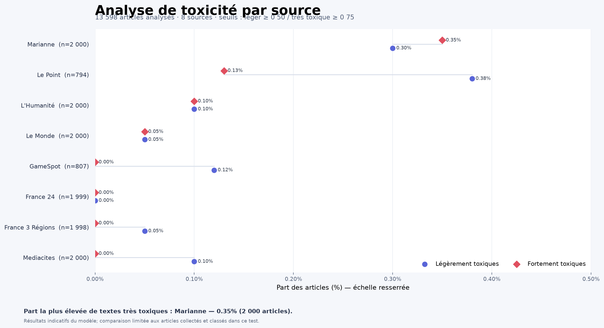
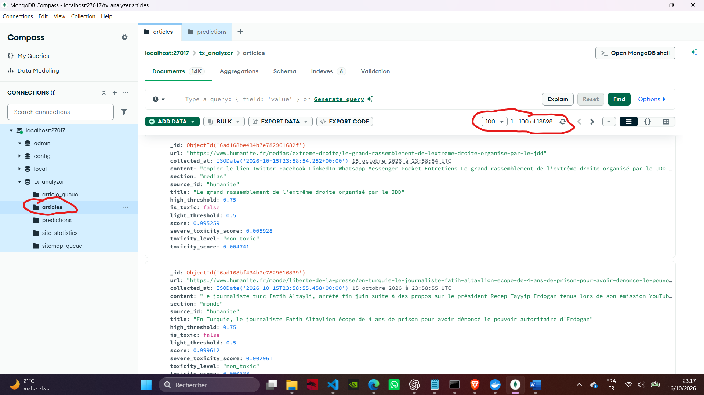
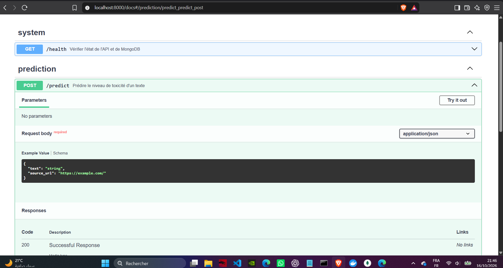
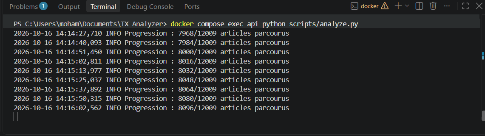
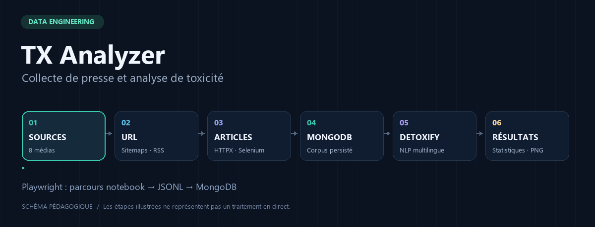

# Galerie et provenance des visuels

[Accueil](../README.md) · [Collecte](collecte.md) · [API et données](api-et-donnees.md)

Les illustrations sont extraites du rapport local `Rapport_TX_Analyzer_Livraison.docx`. Elles sont publiées dans leur format original, sans modification de contenu. Le rapport complet et les données collectées ne sont pas ajoutés au dépôt.

## Analyse complète

**Figure 1 du rapport.** Le graphique décrit 13 598 articles sur huit sources après chargement et déduplication, dont 794 articles Le Point et 807 GameSpot. Les seuils sont 0,50 et 0,75. L’axe est resserré; les résultats ne représentent pas toutes les publications de chaque média.

Le rapport indique que les prédictions manquantes ont été complétées avant cet instantané final. Ce résultat historique n’a pas été recalculé lors de la mise en forme du dépôt.

## Articles dans MongoDB

**Figure 2 du rapport.** Compass affiche 13 598 articles. La capture montre les champs de collecte et de classification. Elle documente une exécution passée, pas un accès à la base depuis GitHub.

## API FastAPI

**Figure 3 du rapport.** L’interface présente GET /health et POST /predict avec le schéma JSON de la requête. Le [guide de démarrage](../README.md#démarrage-rapide) explique comment l’ouvrir localement.

## Analyse en cours

**Figure 4 du rapport.** Le traitement affichait 8 096 articles parcourus sur les 12 009 présents à cette étape. Cette capture est antérieure à l’analyse finale de 13 598 articles et ne constitue pas un benchmark.

## Animation du pipeline

Cette animation pédagogique a été créée pour le dépôt. Elle ne reproduit pas une exécution enregistrée et ne mesure pas le temps des opérations. Le parcours principal est simplifié en six étapes; le notebook Playwright rejoint MongoDB via JSONL. Une [version statique](assets/pipeline-poster.png) est disponible.

Les captures sont stockées dans le dépôt pour éviter une dépendance à un hébergement d’images externe.
